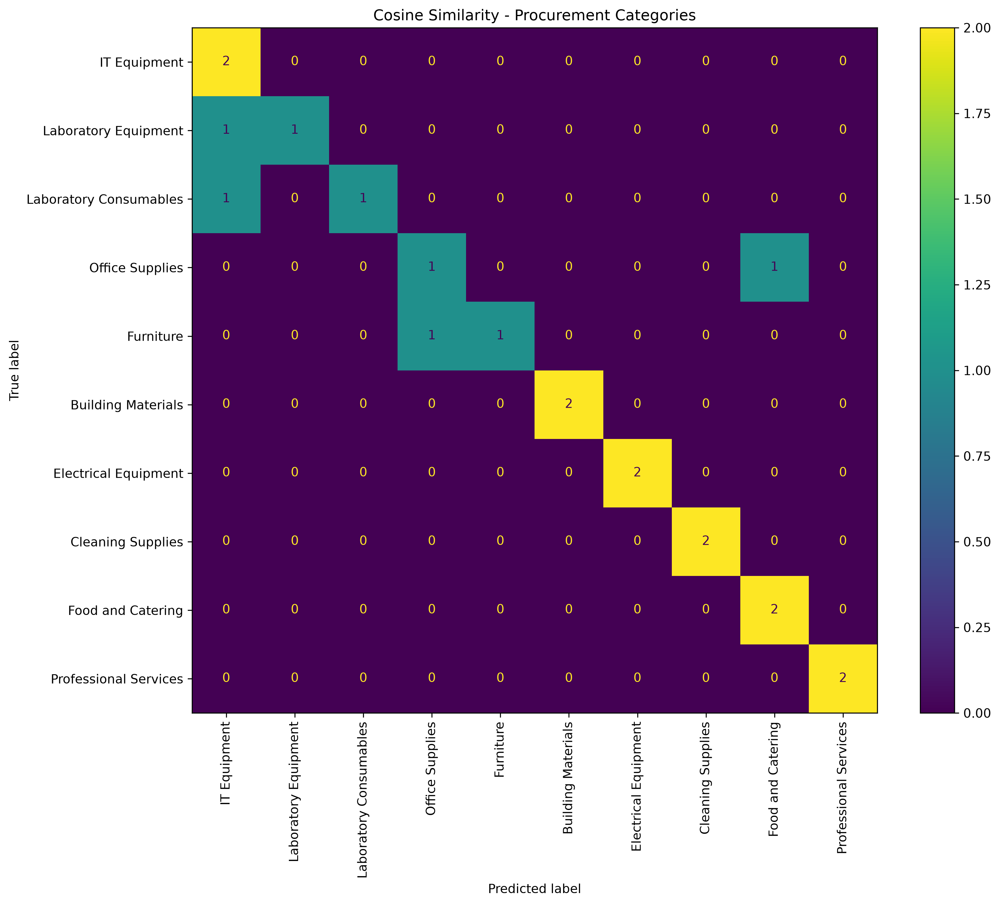
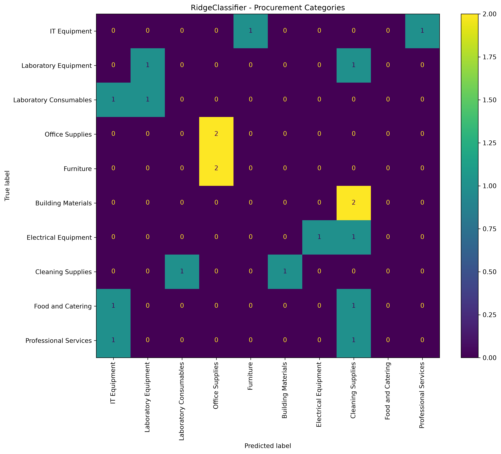

# GHG-Matching
*Natural language processing project that maps procurement descriptions to emission factor categories relevant for Scope 3 emissions and flags ambiguous matches for manual check*

## Background & Objective

Matching purchased goods and services to appropriate emission-factor categories is an important step in Scope 3 greenhouse gas emissions accounting. This project explores the application of natural language processing (NLP) techniques to automate procurement classification while flagging uncertain matches for manual review. Using synthetic university procurement data, it demonstrates an, albeit simplified, approach to a key step in spend-based and activity-based emissions accounting.

## Quick Start

Clone the repository and navigate to the project directory.

Create and activate a virtual environment:

```bash
python -m venv .venv
source .venv/bin/activate
```

Install the required dependencies:

```bash
pip install -r requirements.txt
```

Run the procurement matching pipeline:

```bash
python matching.py
```

Run the model evaluation:

```bash
python evaluation.py
```

The generated predictions and confusion matrices are saved in the `results/` directory.

## Repository Structure

```text
GHG-Matching/
├── data/
│   ├── procurement.csv           # Synthetic procurement records
│   └── categories.csv            # Emission-factor categories
├── results/
│   ├── predictions.csv           # Matched purchases and review flags
│   ├── confusion_matrix_cos.png
│   └── confusion_matrix_ridge.png
├── matching.py                   # Procurement matching pipeline
├── evaluation.py                 # Model comparison and evaluation
├── test_matching.py              # Tests for the matching pipeline
├── requirements.txt              # Python dependencies
├── .gitignore
└── README.md
```

## Methods

### Input & Output

The matching pipeline uses two CSV files stored in the `data/` directory:

- `procurement.csv`: synthetic university procurement records (purchase_id, description, true_category_id). The true_category_id is only required for evaluation.

- `categories.csv`: predefined emission-factor categories (category_id, category_name, category_description).

The main deliverable of `matching.py` is `results/predictions.csv`, containing the original procurement descriptions, assigned emission-factor categories, cosine similarity scores and manual review flags.

### TF-IDF & Cosine Similarity

**Term frequency - Inverse document frequency (TF-IDF)**

Procurement and category descriptions are preprocessed by removing punctuation, converting text to lowercase and normalizing whitespace. 

A TF-IDF vectorizer is used to tokenize the descriptions and weight the frequencies of individual tokens. Words that appear across many documents (e.g. "and", "or", "with") receive lower weights, as they generally provide less useful information for distinguishing between procurement categories. The vectorizer is fitted on a corpus of procurement and category descriptions to include a wider vocabulary that considers both sources in a shared feature space.

**Cosine Similarity**

Cosine similarity measures the similarity between procurement and category descriptions vectors based on their orientation in the feature space. Since TF-IDF weights are nonnegative, the resulting similarity scores range from 0 (no shared terms) to 1 (vectors in the same direction). Each procurement is assigned to the category with the highest cosine similarity score. 

As TF-IDF relies on lexical information rather than semantic relationships, a low similarity score does not necessarily indicate an incorrect match. Similarity scores should not be interpreted as calibrated prediction probabilities (e.g., it might have been the case that the words in the procurement description simply did not appear in the category descriptions)

### RidgeClassifier

A RidgeClassifier serves as a supervised learning benchmark for the TF-IDF and cosine similarity approach during evaluation. It is trained on the TF-IDF vectors of procurement descriptions and their corresponding true_category_id. 

The ridge classifier applies an L2 regularization, penalizing the sum of squared coefficients to discourage excessively large weights and reduce overfitting.

### Manual Review Flagging

For more accurate matching, the automatic prediction pipeline is supplied with a manual review flagger. 

A heuristic default thershold for the maximum cosine score per procurement of 0.1 has been chosen to build the flagging function, but any user-specified threshold is allowed. For real-world implementation, a sensitivity analysis is required to choose a robust default threshold that balances matching accuracy and manual review workload.

The flagging system is especially relevant when all similarity scores for a procurement are zero. In such cases, the assigned category is by default the first category in `categories.csv`. These should not be treated as valid predictions, and must be manually checked.

## Evaluation & Results

The file `evaluation.py` compares two classification approaches using TF-IDF representations: cosine similarity and RidgeClassifier, the latter serving as a supervised learning benchmark. 

The procurement dataset is divided into a stratified training and test set (30/20 samples), using a fixed random state of 42 for reproducibility. To avoid data leakage, the TF-IDF vectorizer is fitted exclusively on the training procurement descriptions and the category descriptions. Both methods are evaluated on the same test set.

### Performance Metrics 

| Metric                       | RidgeClassifier | Cosine Similarity |
|------------------------------|----------------:|------------------:|
| Overall accuracy             | 20.0%           | 80.0%             |
| Correct predictions          | 4/20            | 16/20             |
| Accuracy of accepted matches | —               | 88.2%             |
| Accepted predictions         | —               | 17/20             |
| Manual review rate           | —               | 15.0%             |
| Zero-similarity rate         | —               | 10.0%             |


On the provided dataset, cosine similarity substantially outperforms RidgeClassifier. This may be partly explained by the limited number of labeled training samples available to the supervised classifier.

Using a similarity threshold of 0.1, three purchases are flagged for manual review, two of which were incorrectly classified. The accuracy among accepted predictions is therefore 88.2%, compared to an overall accuracy of 80%.

The small synthetic procurement dataset and the use of a single train/test split limit the generalizability of these results.

### Confusion Matrices

**Cosine Similarity**



**RidgeClassifier**



`evaluation.py` generates a confusion matrix for each classification approach, saved in the `results/` directory, alongside a summary of evaluation metrics in the terminal.

## Testing
The file `test_matching.py` contains a series of tests for the text normalization and manual review flagging functions, covering:

- Text normalization, including punctuation, capitalization, excess whitespace and empty strings.
- Zero and low cosine similarity scores.
- Threshold boundary conditions and custom thresholds.
- Input validation (missing required columns and empty datasets)

To run the tests from the project directory:

```bash
python test_matching.py
```

If all tests pass, the script prints `All tests passed.`

All tests in this repository have been passed by the published code.

## Limitations & Future Work

### Limitations

- Small synthetic procurement dataset and a single train/test split, limiting the generalizability of the evaluation results
- TF-IDF-based cosine similarity only measures lexical similarity, not prediction confidence or semantic relationships
- Synthetic procurement descriptions may differ substantially from real-world records, which can contain abbreviations, supplier names or product codes
- Limited number and detail of emission category descriptions
- Heuristic threshold for flagging function, rather than an empirically optimized one
- TF-IDF weights include statistics from the entire corpus, meaning that refitting the vectorizer on an expanded procurement dataset will change existing predictions

### Future Work

- Evaluating the pipeline on larger, real-world procurement datasets
- Conducting a threshold sensitivity analysis 
- Comparing TF-IDF with more sophisticated NLP methods, such as semantic embeddings
- Expanding the number and detail of categories using official emission-factor categories
- Extending the pipeline to calculate Scope 3 emissions using expenditure or activity data for the corresponding emission factors

## References

- [scikit-learn: TF-IDF Vectorizer](https://scikit-learn.org/stable/modules/generated/sklearn.feature_extraction.text.TfidfVectorizer.html)
- [scikit-learn: Cosine Similarity](https://scikit-learn.org/stable/modules/generated/sklearn.metrics.pairwise.cosine_similarity.html)
- [scikit-learn: RidgeClassifier](https://scikit-learn.org/stable/modules/generated/sklearn.linear_model.RidgeClassifier.html)